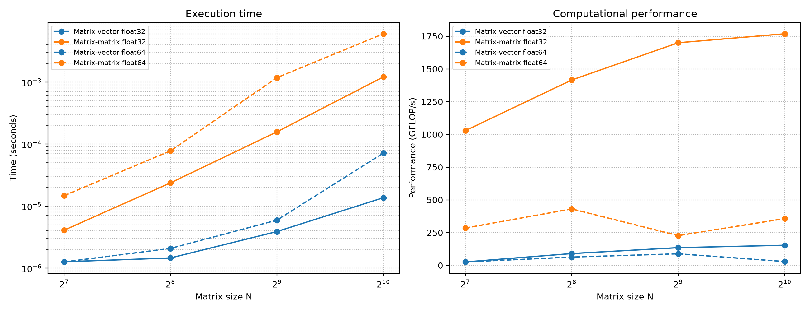

# Numerical Precision and Stability

## Requirements
- Python 3
- NumPy
- Matplotlib

## Run the benchmark
From the repository root, run:

```bash
python3 4_Numerical_precision_and_stability/benchmark.py
```

## Generate the plots

From the repository root, run:

```bash
python3 4_Numerical_precision_and_stability/plot_results.py
```


This script reads `results.csv` and saves `performance_plots.png` in this folder.

## Results

The benchmark data is saved in `results.csv`.

