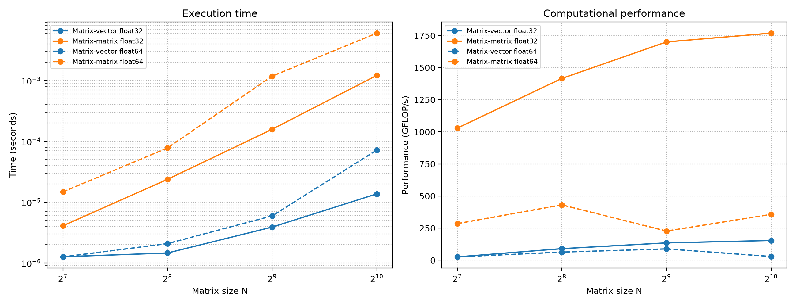

# Roofline Model Performance Analysis

## 1. Objective

This report compares the performance of matrix–vector multiplication and matrix–matrix multiplication using NumPy. The experiments use `float32` and `float64` data types and different matrix sizes. The results are analysed using execution time, computational performance, memory bandwidth, and arithmetic intensity.

## 2. Theoretical estimates

Let `N` be the number of rows and columns, and let `s` be the number of bytes used by each value (`4` for `float32` and `8` for `float64`).

### Matrix–vector multiplication

For an `N × N` matrix and a vector of length `N`, the operation count is approximately:

- FLOPs: `2N²` (one multiplication and one addition for each matrix element)
- Estimated data traffic: `s(N² + 2N)` bytes, counting the matrix, input vector, and output vector once each
- Arithmetic intensity: `2N² / [s(N² + 2N)]` FLOP/byte

### Matrix–matrix multiplication

For two `N × N` matrices, the operation count is approximately:

- FLOPs: `2N³` (one multiplication and one addition for each term in the result)
- Estimated data traffic: `3sN²` bytes, counting both input matrices and the output matrix once each
- Arithmetic intensity: `2N³ / (3sN²)` FLOP/byte

These data-traffic estimates assume each input and output array is transferred once. Actual memory traffic may differ because of cache behaviour, data reuse, and NumPy's implementation. The estimates are therefore idealised values, not direct measurements.

## 3. Experimental methodology

The benchmarks were run with NumPy using matrix sizes `N = 128, 256, 512, 1024` and both `float32` and `float64` data types. Each operation was run 20 times, and the reported execution time is the average of those measurements.

Before timing, each operation was run once as a warm-up. Array creation and initialization were performed outside the timed section. The measurements used Python's `time.perf_counter()` function.

Computational performance was calculated as the estimated FLOP count divided by the measured execution time. Effective bandwidth was estimated by dividing the assumed data traffic by the execution time. These bandwidth values are estimates based on the memory-traffic assumptions in Section 2.

## 4. Experimental results

The benchmark results are shown below. The left plot compares execution time, while the right plot compares computational performance for matrix sizes from 128 to 1024.

Execution time increases as the matrix size grows. Matrix–matrix multiplication takes longer than matrix–vector multiplication, especially for larger matrices. This is expected because their operation counts grow approximately as O(N³) and O(N²), respectively.

Matrix–matrix multiplication achieves higher computational performance than matrix–vector multiplication. Reusing matrix data during the multiplication gives it a higher arithmetic intensity.

In these measurements, float32 generally achieves higher performance than float64 for matrix–matrix multiplication. The matrix–vector results vary more between sizes. Since some measured times are extremely short, timing overhead and system activity may affect the results, particularly for smaller matrices.

## 5. Discussion

### 5.1 How does execution time scale with problem size?

As the matrix size N increases, the execution time of both operations generally increases. Matrix–vector multiplication requires approximately O(N²) operations, while matrix–matrix multiplication requires approximately O(N³) operations. Therefore, when N doubles, their execution times are expected to increase by roughly four times and eight times, respectively. The measurements broadly follow this pattern, although the results do not scale perfectly because of timing overhead, caching, and other system effects.

### 5.2 How does matrix–vector performance compare with matrix–matrix performance?

Matrix–matrix multiplication achieves higher computational performance than matrix–vector multiplication in these measurements. It performs more arithmetic operations for each amount of data transferred, so its arithmetic intensity is higher. Matrix–matrix multiplication also reuses input matrix values across many calculations. By comparison, matrix–vector multiplication has lower arithmetic intensity and is more affected by memory traffic. Although matrix–matrix multiplication takes longer in total, its measured GFLOP/s is higher because it performs many more operations.

### 5.3 How does numerical precision affect performance?

In these measurements, float32 generally gives higher computational performance than float64 for matrix-matrix multiplication, especially for larger matrices. Float32 uses 4 bytes per value, while float64 uses 8 bytes, so it requires less memory traffic for the same arrays. This can improve performance. The matrix-vector results are less consistent, particularly for small matrices, because the measured times are very short and can be affected by timing overhead and system activity. Therefore, the results show a benefit from float32 in many cases, but the size of the benefit depends on the operation and matrix size.

### 5.4 Are there any unexpected results?

The measured performance does not increase smoothly for every matrix size. Some execution times, especially for smaller matrices, are extremely short, so timer overhead, caching, and other system activity can have a noticeable effect. The estimated memory traffic also assumes that each input and output array is transferred once, but actual memory traffic may differ because of cache behaviour and NumPy's implementation. These factors may explain why some measured values differ from the theoretical expectations.
